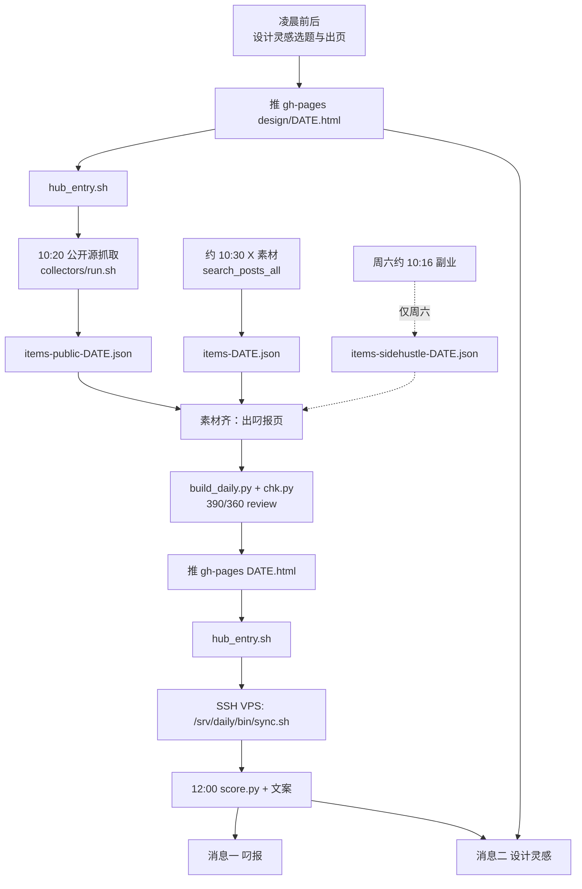
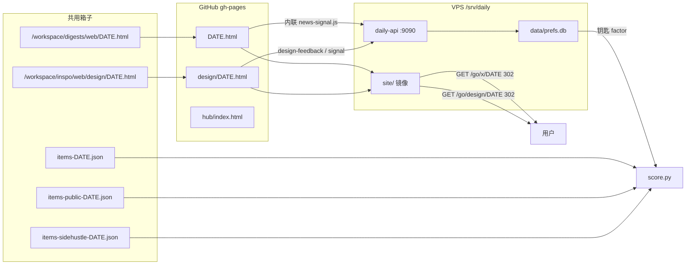

# 每日流程图

时区：Asia/Shanghai（UTC+8）。所有日期 `DATE` 为当天 `YYYY-MM-DD`。

门户路由（nginx，详见 `nginx-standalone.example.conf`）：

- `GET /go/x/DATE` → daily-api 记已读 → 302 `/x/DATE.html`
- `GET /go/design/DATE` → 302 `/design/DATE.html`
- `/x/` alias 到 `/srv/daily/site/`（对应 gh-pages 根目录的 `DATE.html`）
- `/design/` alias 到 `/srv/daily/site/design/`
- nginx 在 `</body>` 前注入 `read-beacon.js` 和 `pwa-nav.js`（只对门户镜像页；github.io 没有这层注入）
